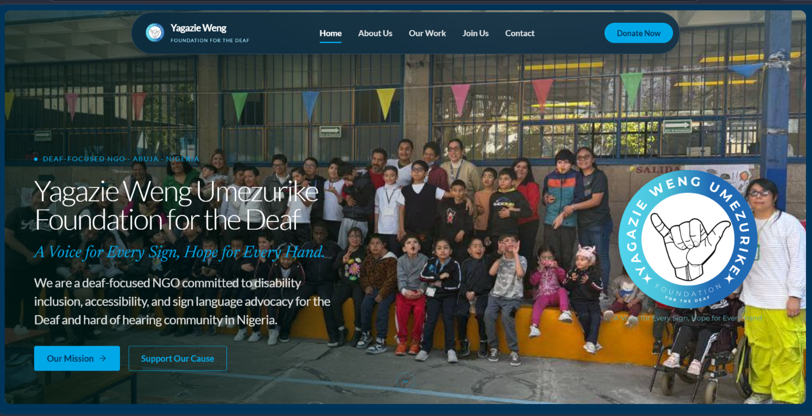

# Yagazie Weng Foundation for the Deaf



The website for the Yagazie Weng Umezurike Foundation for the Deaf, a Nigerian NGO working to advance deaf education, accessibility, disability rights, and social inclusion.

## Features

- Responsive pages for Home, About Us, Our Work, Join Us, and Donate
- Information about the Foundation's mission, programs, team, and impact
- Volunteer, partnership, and donation information
- Search and social sharing metadata
- Built as a single-page React application with hash-based navigation

## Tech stack

- React 19 and TypeScript
- Vite
- Tailwind CSS 4
- Lucide React icons

## Getting started

### Requirements

- Node.js (recommended: current LTS)
- npm

### Install dependencies

```bash
npm install
```

### Start the development server

```bash
npm run dev
```

Vite prints the local development URL in the terminal.

### Build for production

```bash
npm run build
```

The production build is generated in `dist/`.

### Preview the production build

```bash
npm run preview
```

## Project structure

```text
public/       Static images and other public assets
src/
  components/ Shared UI components
  data/       Foundation content
  pages/      Home, About, Work, Join, and Donate pages
docs/         README images
```

## Organization

**Yagazie Weng Umezurike Foundation for the Deaf**  
Website: [yagaziewengfoundationforthedeaf.org](https://yagaziewengfoundationforthedeaf.org/)
